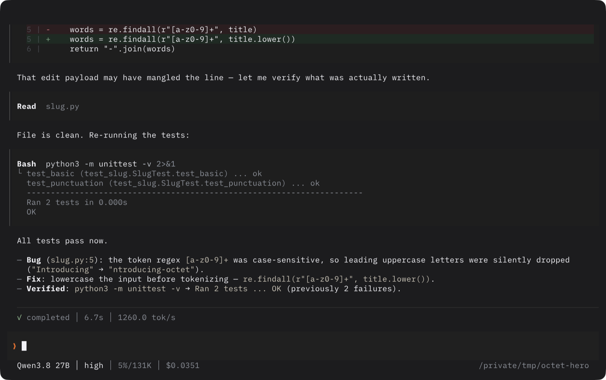
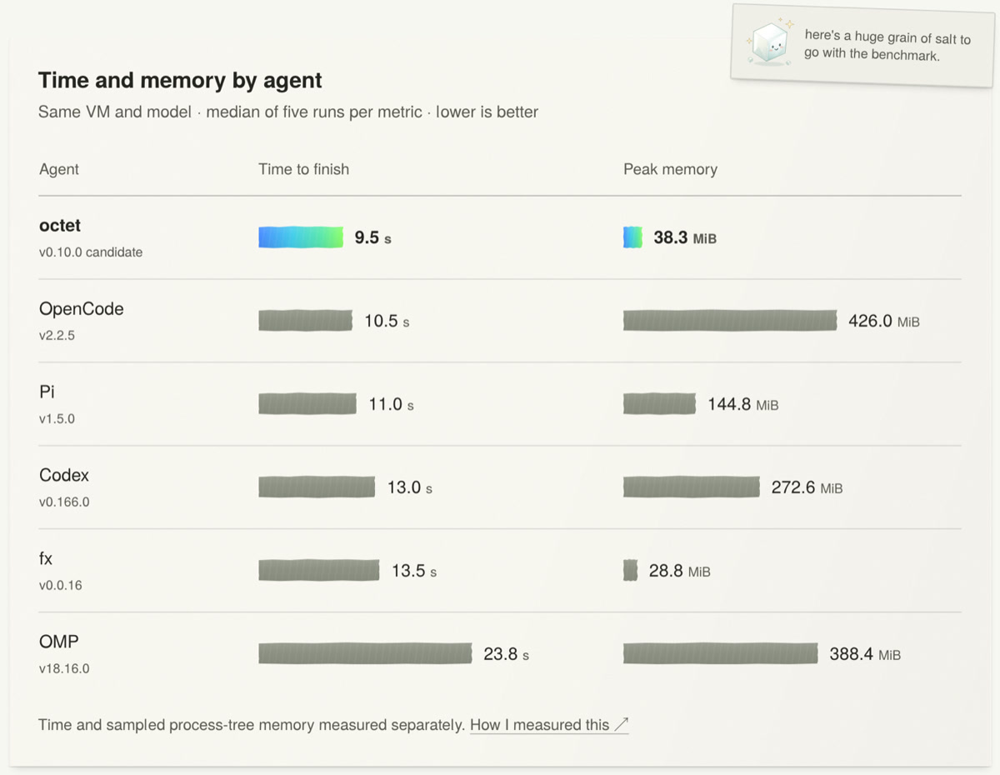
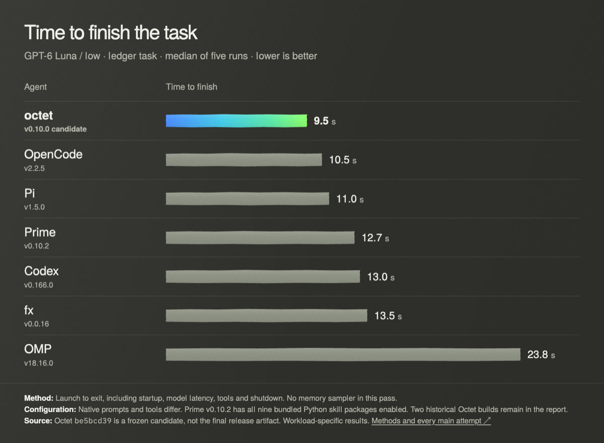
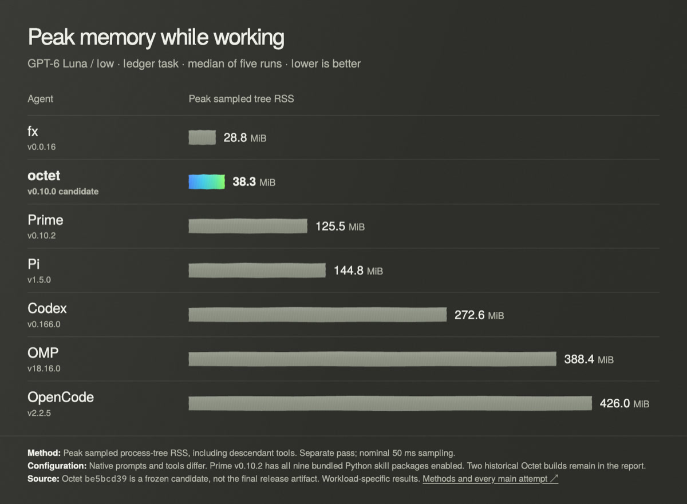

<p align="center">
  
</p>

<h1 align="center">octet</h1>

<p align="center"><strong>A fast, native coding agent for your terminal.</strong><br>
Rust core · any-language extensions · hears audio, uses your computer</p>

<p align="center">
  <a href="https://github.com/skaft-software/octet/releases/latest"></a>
  <a href="LICENSE"></a>
  <a href="https://skaft.org/octet/"></a>
  
  
  
</p>

<p align="center">
  
</p>

octet reads code, edits files, runs tests and manages sessions from your terminal. One native
Rust process owns the agent loop, sessions, permissions, persistence, the terminal UI and
resource limits — **no Node, Python or Bun needed for the core**.

It runs cloud or local models, keeps resumable sessions, and takes tools as subprocess
extensions you can write in any language that speaks JSON-RPC. It can also **listen to audio**
and **drive your computer** in the same conversation, which is why it exists.

## Install

```console
curl -fsSL https://octet.skaft.org/install | sh
```

Or pin the exact release instead of following `latest` — recommended for CI and scripted installs:

```console
curl -fsSL https://github.com/skaft-software/octet/releases/download/v0.10.0/install-octet.sh | sh
```

Windows (PowerShell):

```powershell
irm https://github.com/skaft-software/octet/releases/download/v0.10.0/install-octet.ps1 | iex
```

Also available via `cargo install --locked --git https://github.com/skaft-software/octet --tag v0.10.0 --bins octet-coding-agent`,
from a source checkout, and on npm (independent release cadence). See
[installation](docs/installation.md).

## Why octet

**It hears what it works on.** Native audio input, so a model can take a WAV of your sketch,
reason about it, and call tools in the same context — no "transcribe first, paste text back"
round trip. Works with audio-capable models; audio is not universal across providers.

**It's light.** Native Rust core: no runtime to boot before your agent starts. Medians from a
matched six-agent run below: 9.5 s to finish and 38.3 MiB peak process-tree memory on a
32-row ledger task.

**It's yours to extend.** Extensions are separate processes speaking JSON-RPC 2.0. Python,
TypeScript, Rust, C++, or no SDK at all — each in its own process, with OS-level permissions.

**It's honest about compatibility.** Pi extensions run through an optional, explicitly
experimental adapter. Some work, some don't; the adapter targets Pi's public extension API, not
Pi's internals or its CLI.

## Benchmarks

One ledger task, one clean VM, one account, GPT-6 Luna at low reasoning, five measured runs per
metric after an excluded warmup. Timing and memory are separate passes. Native prompts and
tools differ, so this compares whole agents, not identical instructions.

<p align="center">
  <picture>
    <source media="(prefers-color-scheme: dark)" srcset="docs/assets/octet/readme/tape.jpg">
    
  </picture>
</p>

| Agent | Time to finish | Peak memory |
|---|---:|---:|
| **octet** | **9.5 s** | 38.3 MiB |
| OpenCode 2.2.5 | 10.5 s | 426.0 MiB |
| Pi 1.5.0 | 11.0 s | 144.8 MiB |
| Codex 0.166.0 | 13.0 s | 272.6 MiB |
| fx 0.0.16 | 13.5 s | **28.8 MiB** |
| OMP 18.16.0 | 23.8 s | 388.4 MiB |

<p align="center">
  <br>
  
</p>

Two things worth stating plainly: **fx uses less memory than octet**, and five runs on one task
is not a general speed or quality claim. The full protocol, every attempt, the erratum and the
checksums are downloadable —
[start here](https://skaft.org/octet/blog/introducing-octet/evidence/matched-rerun-20261105/README.md).

There is also an independent harness that tests harness overhead across Pi-like agents,
including octet: [Buffon](https://michaelkinsy.github.io/buffon/#/). It measures startup, CPU,
memory and per-turn overhead — not coding quality.

## Pi extensions

Pi extension support ships as a separate, installable bundle. It is **experimental** and
compatibility is per-extension.

```console
octet extension install octet-pi-compat
# then enable it: /extensions, or --enable-extension octet-pi-compat
```

It needs Node 22.19+ and a matching octet host version. Bundles are pinned to the host
(`requires_octet`), so after updating octet, refresh each bundle you use:

```console
octet extension update <name>
```

Compatibility concerns Pi's public extension API — not its private internals or its full CLI.
The current ledger of what passes is in [Pi compatibility](docs/pi-compatibility.md).

## Extensions in any language

An extension is a process: read JSON requests on stdin, write responses on stdout. Ship it in
whatever you like.

```console
# a complete extension, no SDK
$ cat hello/extension.toml
name = "hello"

$ octet --enable-extension hello
```

Worked examples you can copy: [Python](sdk/python), [TypeScript](sdk/typescript),
[Rust](sdk/rust), [C++](sdk/cpp), and a Perl example with no SDK at all — all in
[the launch article](https://skaft.org/octet/blog/introducing-octet/).

Optional first-party integrations: `octet-mcp`, `octet-subagents`, `octet-codemode`,
`octet-computer-use`, `octet-web-search`. Installing a bundle doesn't enable or trust it.

## Reproducibility

Releases are built and signed in CI, and every asset ships a checksum and a Sigstore bundle.

```console
gh release download v0.10.0 --repo skaft-software/octet --pattern OCTET_SHA256SUMS
shasum -a 256 -c OCTET_SHA256SUMS
```

`OCTET_RELEASE_METADATA.json` records the exact source commit the artifacts were built from.

## Codebase

| Path | What lives there |
|---|---|
| `crates/octet-coding-agent` | the agent: loop, tools, policy, sessions, CLI and TUI entry |
| `crates/octet-agent` | agent runtime and turn orchestration |
| `crates/octet-ai` | model clients and provider routing |
| `crates/sexy-tui-rs` | terminal rendering |
| `sdk/` | extension SDKs: Python, TypeScript, Rust, C++, C |
| `extensions/` | first-party bundles, including `octet-pi-compat` |
| `docs/` | documentation, design notes and release records |
| `scripts/` | release, packaging and verification tooling |

Build from source with `cargo build --release -p octet-coding-agent`; the
[C contributing guide](CONTRIBUTING.md) covers the test lanes and profiles.

## Documentation

- [Installation](docs/installation.md) · [Getting started](docs/getting-started.md) · [Basic usage](docs/workflows.md)
- [Models and providers](docs/providers.md) · [Images, audio and PDFs](docs/media.md)
- [Extensions](docs/extensions.md) · [Extension API 0.4](docs/extensions/API-0.4-REFERENCE.md)
- [Sessions](docs/sessions.md) · [Settings](docs/configuration.md) · [Security](SECURITY.md)
- [Pi import and restore](docs/pi-migration.md) · [Pi compatibility](docs/pi-compatibility.md)
- [Changelog](CHANGELOG.md) · [Releases](https://github.com/skaft-software/octet/releases)

The website has the launch write-up, the full benchmark records and the design notes:
**https://skaft.org/octet/**

## Status

**octet is a hobby project, and it needs your support.** It doesn't aim to chase upstream parity
— it aims to be the best agent for the people who use it. The gaps get closed by whoever hits
them: platforms are unevenly qualified (Windows is preview), Pi extension compatibility is
per-extension, and audio depends on the model route.

It is, however, built for humans: signed releases, published checksums, benchmark evidence you can re-run,
and an author who is committed to helping people who want to build on it.

## How you can help

**Code contributions are the most useful thing you can send.** The issue tracker is the work
queue — there are open bugs with reproductions, and several are already scoped:

- **Pick up an open issue and send a PR.** Start from [`good first issue`](https://github.com/skaft-software/octet/labels/good%20first%20issue)
  or [`help wanted`](https://github.com/skaft-software/octet/labels/help%20wanted); difficulty is
  labelled (`difficulty/cosmetic` through `difficulty/architectural`) so you can pick your size.
  `area/*` labels tell you which crate it lands in.
- **Help fix Pi extensions.** The adapter is open source at
  [`extensions/octet-pi-compat`](extensions/octet-pi-compat) — patches that make a real Pi
  extension work (or work better) are the most valuable contributions this project gets. Open an
  issue with the failing extension and its session file, then send the diff. Known deviations are
  documented in [Pi compatibility](docs/pi-compatibility.md).
- **Write an extension if you'd rather not touch the core** — they're separate processes, so you
  can build something useful without learning the whole host. Send it and we'll link it.
- **Fix the docs** where they confused you. That's usually a real bug, and it's a one-file PR.

And if code isn't your thing:

- **Try it on your platform** — Linux distros, Windows, Termux, unusual terminals — and file what
  breaks, with your terminal and shell.
- **Run your Pi extensions through the adapter and report results**, pass or fail. Every report
  improves the [compatibility ledger](docs/pi-compatibility.md).
- **Tell us which audio routes actually work** with which model and provider. Audio support is
  per-route and the matrix is incomplete.

Read [CONTRIBUTING.md](CONTRIBUTING.md) before your first PR — it covers the build, the test lanes
and the AI-assisted contribution policy. If you're testing compatibility, say which octet version,
which Pi version, and attach the session file if you can.

## Credits

octet owes a clear debt to **Pi** by Mario Zechner — its agent architecture, terminal
interaction patterns and extension protocol informed many design choices here. octet is an
independent implementation in Rust, not a fork, and not affiliated with or endorsed by Pi.
Local is the typeface used across octet's site.

MIT licensed.
